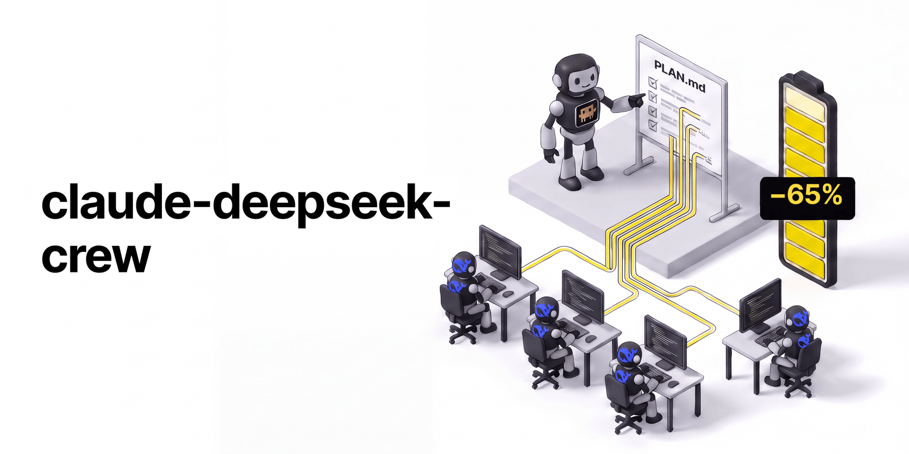

[🇮🇹 Italiano](README.md) · **🇬🇧 English**



# claude-deepseek-crew

**Opus plans. DeepSeek writes the code. You save 65% of your Claude subscription usage.**

When you ask Claude Code to build something, most of your usage doesn't go into thinking. It goes into the manual work:
writing files, re-reading them, running tests, fixing, running them again. claude-deepseek-crew splits that work in
two. **Opus 5.5 is the tech lead**: it understands the request, writes the plan and checks the result. **The developers
are Claude Code sessions running on DeepSeek V4.1 Flash**, a model that costs a fraction of a cent per thousand lines,
and they do everything else.

The result, measured on 6 apps with hidden tests: the same quality as Opus alone, a third of the plan usage and a few
cents of DeepSeek.

| | Opus does everything | **Opus lead + DeepSeek crew** |
|---|---|---|
| Hidden acceptance tests passed | 100% | **100%** |
| Claude usage (your plan limits) | 100% | **35%  (−65%)** |
| Extra cost | – | ~$0.15 of DeepSeek per app |
| On the largest app (5 modules, 220 tests) | 100% | **17%  (−83%)** |

<sub>Benchmark: 6 web apps built from a spec, graded by hidden acceptance tests the agents never saw, repeated runs per setup.
Claude usage measured from real token counts. Full data and method: [docs/BENCHMARK.en.md](docs/BENCHMARK.en.md).</sub>

## How it works

```
you ──► Opus (your Claude Code session, on your plan)
          │  1. reads the request and the repository
          │  2. writes PLAN.md: structure, data, rules, list of tasks
          │  3. hands the tasks out with ds-worker
          ▼
        DeepSeek developer (Claude Code on DeepSeek, on your DeepSeek account)
          │  writes the code, runs the tests, fixes
          │  returns a report: files touched, how it verified, what is still open
          ▼
        Opus reads the report ─► accepts, or sends back fixes
          │
you ◄─────┘  final summary: what was built, how it was verified, what it cost
```

The developer is not a different program: it is **the same Claude Code**, with the same tools (reading and writing
files, terminal, tests), but connected to DeepSeek's Anthropic-compatible endpoint instead of Anthropic's servers. It
works in your project folder, with a separate config that does not contain your Claude login.

You only talk to Opus, as usual. The `/deepseek-crew` command tells it to act as a tech lead: it doesn't write
application code, it delegates.

## Why it saves usage

Working alone, Opus spends most of its tokens on implementation: generating code, re-reading files,
reading test output, iterating. With the crew, DeepSeek pays for that part. Opus only spends tokens on understanding,
planning and reading reports, which is the work where a frontier model really makes a difference.

That's why **the saving grows with the size of the job**: −55% on the smallest app, −83% on the 5-module suite.
On a tiny task (a one-line fix) it's the other way round: the lead still has to read and plan, and that fixed cost
cancels the saving. Use plain Claude Code there.

DeepSeek is cheap for another reason too: Claude Code resends the same context a lot, and DeepSeek serves it from cache
98% of the time at $0.003 per million tokens. A whole app costs a few cents.

## Two modes

| | fast mode (default) | `--review` |
|---|---|---|
| What Opus does | reads the developers' reports and trusts them | runs the tests, tries the app, reads the critical code and sends problems back |
| Claude usage vs Opus alone | **35%** | 56% |
| Hidden tests passed in the benchmark | 100% | 100% |

Review costs almost as much as doing the work, because to verify it Opus has to re-read the spec, the plan and the
code. In my tests the specs were precise and quality was already 100% without review. Use `--review` when the request
is ambiguous or the code is delicate and you want a second pair of eyes before accepting it.

## When it pays off

- **Yes:** new apps or features of some size, with clear requirements or requirements Opus can make clear in the plan.
  The bigger the job, the bigger the saving.
- **No:** fixes of a few lines, questions about the code, quick explorations. Use plain Claude Code for those.
- **Not measured yet:** vague requests, large long-lived codebases, debugging sessions. It probably works, but I have
  no numbers.
- **Time:** the crew is slower. In the benchmark an app took 12 minutes on average versus 4 for Opus alone (times
  inflated by many runs in parallel on the same machine). You save usage, not time.

## Get started in 2 minutes

You need [Claude Code](https://code.claude.com), Python 3 and a [DeepSeek API key](https://platform.deepseek.com/api_keys) with a few dollars of credit.

**The easy way:** open Claude Code and paste the prompt from [INSTALL_WITH_CLAUDE.md](INSTALL_WITH_CLAUDE.md).
Claude checks the requirements, installs everything, has you save the DeepSeek key without it going through the chat, and runs the test.

**By hand:**

```bash
git clone https://github.com/lucadidomenico/claude-deepseek-crew.git
cd claude-deepseek-crew
./install.sh --test     # if the DeepSeek key is missing it tells you how to save it; then run it again
```

`--test` makes one tiny DeepSeek call (about $0.002) and prints `TEST PASSED`.

## Your first job

Open Claude Code in your project, pick Opus and give it the job:

```
/model opus
/deepseek-crew build the app described in SPEC.md
```

Opus reads `SPEC.md` and the repository, writes `PLAN.md` and starts one or more developers. While they work you see
Opus waiting on the `ds-worker` command: each developer takes from a few minutes to half an hour. At the end Opus tells
you what was built, how it was verified, what is still open and what it cost on DeepSeek.

With review:

```
/deepseek-crew --review build the app described in SPEC.md
```

You don't need a written spec: you can describe the job right in the command. The more precise the request, the better
the developers work.

## What's inside

| | |
|---|---|
| `/deepseek-crew` | Claude Code skill: Opus becomes tech lead and delegates to DeepSeek. With `--review` Opus verifies each delivery. |
| `ds-worker` | The command Opus uses to delegate: one task → one DeepSeek-powered Claude Code session → a report. Use it yourself too: `ds-worker "add pagination to /api/items, with tests"`. With `--resume w01 "..."` you give more work to the same developer, who remembers what it did. |
| `ds-worker-batch` | Several independent tasks in parallel, on different files. |
| `ds-cost` | What the DeepSeek developers really cost. Claude Code's `/cost` uses Claude prices and is about 40× off with DeepSeek. |
| `ds-claude` | Plain Claude Code running on DeepSeek, for when you don't need a lead. |

Developer transcripts, task texts and costs are kept in `./.crew/` in your project, so you can always check what each
developer did.
Messages are in Italian or English depending on your system language; force one with `CREW_LANG=it` or `CREW_LANG=en`.

## Pro or Max?

Both. The crew matters most where limits bite:

- **Pro ($20):** at the rates I measured, a Pro 5-hour window fits about 18 mid-size apps with Opus alone, and
  **about 64 with the crew**. For the 5-module app: about 7 vs **about 42**.
- **Max:** you hit the weekly cap about 3× later, and long sessions stop being a quota problem.

Anthropic does not publish limits in tokens. I calibrated them on a Max 20x plan and scaled to Pro with the 20× ratio
per 5-hour session that Anthropic states. Details are in the benchmark.

## Install options

```bash
./install.sh                    # tools in ~/.local/bin, skill in ~/.claude/skills/deepseek-crew
./install.sh --test             # same, plus a full check for about $0.002
./install.sh --no-skill         # tools only, no skill
PREFIX=/opt/crew ./install.sh   # install the tools somewhere else
./install.sh --uninstall        # remove everything it installed
```

Requirements: `claude`, `python3`, `flock` and `timeout` (preinstalled on Linux; on macOS: `brew install flock coreutils`).
To use the skill in one project only, copy `skill/deepseek-crew` to `<project>/.claude/skills/`.

## Safety and costs

- **Your Claude login stays out of it.** Developers run with a separate config folder and no Anthropic credentials:
  even by mistake they cannot spend your plan or call the paid Anthropic API. If credentials ever show up in that
  folder, the tools refuse to start.
- **Where the DeepSeek key lives:** in the file `~/.config/claude-deepseek-crew/env` (permissions 600) or in the
  `DEEPSEEK_API_KEY` variable. The file is created with the command printed by `./install.sh`, which asks for the key without showing it.
- **Never `export` the DeepSeek variables** (`ANTHROPIC_BASE_URL`, `ANTHROPIC_AUTH_TOKEN`...) in your shell: they would
  redirect your normal Claude Code too. The tools set them only inside the developer processes.
- **Billing:** the lead is your normal Claude Code session, so it counts against your plan limits as usual (Anthropic
  help center, updated 2026-10-07). The developers only bill your DeepSeek account.
- **Peak hours:** DeepSeek charges 2× from 01:00 to 04:00 and from 06:00 to 10:00 UTC, Monday to Friday.
- **No web search for developers.** From 2026-11-01 DeepSeek bills server-side search and fetch per request, so the tools
  turn `WebSearch` and `WebFetch` off for developers. Put the docs they need in the repo or in the task.
- **Developers run with full permissions** (`bypassPermissions`), so they never stop to ask. Treat them like an intern
  with root access to a sandbox: use a disposable checkout, a container or a VM. In my benchmark some developers ran
  `pkill` on unrelated processes, wrote outside the project folder, or went looking for the hidden tests.

## How I verified it

In the benchmark every DeepSeek request went through a logging proxy, with the model name checked in both request and response.
`strace` on a developer process showed no connection except the configured endpoint. A control run with the same config
and no DeepSeek variables is "Not logged in" to Claude. The token counts `ds-cost` reads matched the proxy exactly, and the
computed DeepSeek cost matched the real account balance within 1%. See [docs/BENCHMARK.en.md](docs/BENCHMARK.en.md).

## Author

Made by **Luca Di Domenico**

- Website: [lucadidomenico.studio](https://lucadidomenico.studio)
- AI Builders Italia: [aibuildersitalia.com](https://aibuildersitalia.com)

## License

[MIT](LICENSE) © 2026 Luca Di Domenico
